# A.R.I.A. — Autonomous Reasoning & Intelligence Assistant

A.R.I.A. turns middle-of-the-night ideas into executed projects with as little
human effort as possible. She is a pipeline over plain markdown folders
(Obsidian-compatible): an idea is captured, classified, researched and
planned; **you approve the plan**; then she works the project — on her own,
batch after batch — until you tell her to stop, and hands you a report of
every change she made and why.

She runs two ways over the same folders: as a **local app** on your own
hardware and models (chat, voice, a task board, autopilot), and inside
**Claude Code** (slash commands, subagents, a project-manager scaffold).

> *"I have way more project ideas than I have time to do those projects."*
> A.R.I.A. exists so the only thing you do by hand is (1) capture the idea and
> (2) review + approve the plan. Everything else is automated.

---

## The pipeline

```
  capture                triage                 develop
 ┌──────────┐  project  ┌───────────────┐      ┌────────────────────────┐
 │ 00-inbox │ ────────▶ │ 01-processing │ ───▶ │ 02-potential-projects/ │
 └──────────┘           └───────────────┘      │   <slug>/              │
      │                                        │     idea.md            │
      │ not a project                          │     research.md        │
      ▼                                        │     proposed-plan.md   │
 knowledge/                                    └────────────────────────┘
   notes/          random ideas & reference               │
   lists/          grocery items, todos          ★ HUMAN IN THE LOOP ★
   content-ideas/  "funny TikTok" material         you read the plan
   someday/        not now, maybe later                   │ approve
                                                          ▼
                                               requirements.md (approved)
                                                          │ promote
                                                          ▼
                                              active-projects/<slug>/
                                                docs/        ← idea, research, plan, requirements
                                                autopilot/   ← her plan, memory, changes, report
                                                STATUS.md, CLAUDE.md, your project's files
```

**The only human touchpoint** is the approval. Nothing gets promoted or
executed without an approved `requirements.md` — and after it, nothing
needs you until you choose to stop her.

## Quickstart

```bash
git clone https://github.com/coneill823/ARIA && cd ARIA
./install.sh      # desktop app + always-on service + skills, in one shot
```

Then open the app (your application menu, or <http://127.0.0.1:8700>) and
talk to her:

| Say or type | What happens |
|---|---|
| `capture <a rambling idea>` | Saved verbatim; triaged and — if it is a project — researched and planned. |
| `approve <project>` | **Your gate.** The plan becomes the requirements; the project gets its own workspace. |
| `work on <project>` | Autopilot: she takes stock, plans, and works task after task. |
| `status of <project>` · `what are you working on` | Where things stand, in a sentence. |
| `tell <project> to <guidance>` | Redirects her without stopping. |
| `approve task t5 in <project>: <your decision>` · `skip task t5 in <project>` | Answers a task she marked as yours to decide. |
| `refine <project>` | She reads the whole codebase, writes up what is worth changing, and refines it without changing what it does. |
| `where is <project>` · `open the folder for <project>` · `open <project> in my editor` | Where the code lives — and one step to it. |
| `run <project>` | Opens its Run tab: the command is there, and starts when you press Run. |
| `stop working on <project>` | She finishes the step in flight and writes the final report. |
| `what changed in <project>` | The latest verified changes. |
| `search for <topic>` · `read <url>` | The live web, answered with sources. |
| `note to brain: <text>` | A note in your Obsidian vault. |
| `ask the <agent> to <task>` · `mission <agent> to <task>` | One agent, now or in the background. |
| `open <projects \| board \| agents \| orb \| settings>` | Takes you there. |

Project names are matched the way you say them — "the meal planner" finds
`receipt-based-meal-planner`. If nothing fits, or two projects fit equally,
she does not guess: she tells you and lists your projects.

In **Claude Code** (`claude` from the repo root) the same pipeline is
driven by slash commands:

| Command | What it does |
|---|---|
| `/capture <rambling idea>` | Drops the idea verbatim into `pipeline/00-inbox/` with frontmatter. |
| `/triage` | Classifies every inbox item (project / task / note / content / someday) and files it. Projects move to `01-processing/`. |
| `/develop [slug]` | Reads "the ramblings of a madman", researches existing tools & prior art on the web, and produces a **proposed plan** in `02-potential-projects/<slug>/`. |
| `/review <slug>` | Interactive review session: you say what you like and don't like; the plan is revised. |
| `/approve <slug>` | Converts the accepted plan into a full **requirements document** and marks it approved. |
| `/promote-project <slug>` | Moves the project out of the pipeline to the active-projects directory, scaffolds a **PM** (`CLAUDE.md`) and its project-specific **subagents**, and hands over execution. |
| `/status` | Dashboard: what's in each stage, what's stalled, full ledger. |

### The command line

Everything the app does is also a command, so it works from cron, SSH or
any automation:

```bash
bin/aria capture "app that turns my grocery receipts into a meal planner"
bin/aria auto                        # triage + plan everything new
bin/aria projects                    # every project, where it lives, what she is doing
bin/aria approve <slug>              # the human gate
bin/aria autopilot <slug> start      # ...stop | status | steer "…" | run | refine
bin/aria autopilot <slug> approve-task t5 "decision"   # ...or skip-task
bin/aria open <slug> editor          # ...folder | terminal — on your desktop
bin/aria run <slug>                  # how it is started (add a number to start it here)
bin/aria check <slug>                # run its tests the way she does: sandboxed
bin/aria models scan                 # your giant models: one per role, loaded on demand
bin/aria adopt <repo|folder> "goal"  # put an existing codebase under autopilot
bin/aria search "query"              # web search      (fetch <url> reads a page)
bin/aria brain "text"                # a note in your Obsidian vault
bin/aria github publish <slug>       # ...init | push | status
bin/aria agent critic "..."          # run one agent   (mission = in the background)
bin/aria skills list                 # the skills pack (convert / prompt too)
bin/aria app                         # the app in a window of her own   (ui = just the server)
bin/aria voice-gateway               # the authenticated door for Alexa
bin/aria install-service             # always-on: server at login + hourly pipeline
bin/aria install-skills              # skills and specialist agents (ECC, Anthropic…)
bin/aria settings                    # your own settings   (set <key> <value> | unset | import)
bin/aria update                      # newest version in, your settings kept, server restarted
bin/aria test --mock                 # self-test in seconds, no GPU needed
bin/aria doctor                      # sanity-check the setup
```

`capture` writes the inbox note instantly (no model call).

### Self-test — prove the whole system works

```bash
bin/aria test --mock   # the machinery, against a stand-in model: seconds
bin/aria test          # the same checks against YOUR models: minutes
bin/aria test --keep   # leave the sandbox on disk to inspect
```

It builds a throwaway copy (your real pipeline, projects and vault are
never touched) and runs everything: capture, spoken commands, triage,
develop with and without web research, the Obsidian brain, the human
gate, promotion, a full autopilot run — plus rejected work, a model-server
outage, stop and resume, a task that waits on you, budgets, the review
pass — the test sandbox (with a deliberately hostile test in it), the
giant-model garage against stand-in servers, a commit per task, a stubbed
GitHub push, adopting a repository, the agent library, the voice gateway
with simulated Alexa requests, and every page and endpoint of the app.
`--mock` proves the plumbing on any machine; without it you prove your
models too. The self-test never touches the internet, never loads one of
your real models, never fires one of your webhooks and never puts
anything on your screen. Run it after every `aria update`.

On real models the autopilot check stops after the first task or two, so
a small model may get nothing verified in that time — the check says so
(`0 verified in 3 attempt(s)`) and still passes: having work sent back is
the loop doing its job. What it tells you is that the **smart** tier
deserves a stronger model.

If the only failure is **backends reachable**, the model server is not
running: `sudo systemctl enable --now ollama` (or `ollama serve`).

### Always-on mode

`./install.sh` (or `bin/aria install-service`) installs two systemd user
units: **aria.service** keeps the server — and with it autopilot and
background missions — running from login, and **aria-auto.timer** runs
the pipeline every hour, so ideas dropped into the inbox (from your phone
via Obsidian sync, or any file drop) become proposed plans while you're
away. Pause with `systemctl --user stop aria-auto.timer`.

### Updating — and where your settings live

```bash
bin/aria update            # the newest version of the branch you are on
bin/aria update main       # …or move to another branch
```

It fast-forwards this copy, lists what changed and restarts the always-on
server — unless autopilot is in the middle of a step, in which case it
leaves her running and tells you how to restart when it suits you
(`--restart` to do it anyway). It never merges, never discards a change
of yours: if a file you edited is also changed upstream it stops and says
which.

Your settings are not part of what gets updated. `system/config.yml`
holds the defaults and the explanation of every key; your own values
live in **`system/config.local.yml`**, which git ignores and which wins
wherever it sets a key. The Settings page writes there, and so does the
command line:

```bash
bin/aria settings                          # what you have changed
bin/aria settings set smart ollama/qwen3:30b
bin/aria settings unset smart              # back to the default
```

If you edited `system/config.yml` by hand — the thing `git pull` trips
over with *"your local changes would be overwritten"* — `aria update`
moves those edits into your own file first and keeps a copy of the file
as you had it (`system/config.backup-….yml`). Coming from a version
without `aria update`:

```bash
cp system/config.yml ~/aria-config-backup.yml   # your edited settings
git checkout -- system/config.yml               # let the new one in
git pull                                        # or: git checkout <branch>
bin/aria settings import ~/aria-config-backup.yml
```

## The app

```bash
bin/aria app
```

A.R.I.A. in a window of her own — her icon in the taskbar, no browser, no
tabs. `./install.sh` puts her in your application menu. The window is only
a face: the work is done by the always-on server, so closing it stops
nothing. A real window needs one toolkit:

```bash
sudo pacman -S python-pyqt6-webengine
```

(GNOME: `python-gobject webkit2gtk-4.1` · Debian/Ubuntu:
`python3-pyqt6.qtwebengine` · anywhere: `pip install PyQt6-WebEngine`.)
Without one she opens as a chromeless browser window, or a tab —
`bin/aria doctor` says which. `bin/aria ui` runs just the server, on
<http://127.0.0.1:8700>.

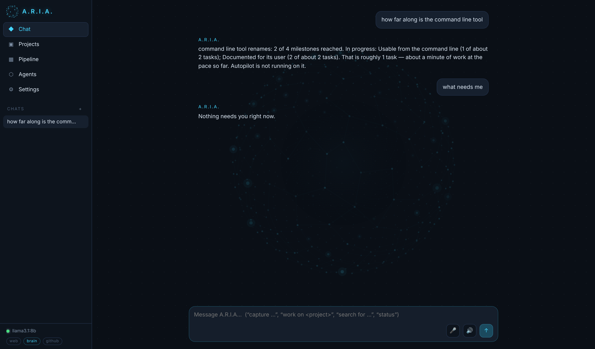

One window. The sidebar stays where it is — Chat, Projects, Pipeline,
Agents, Orb, Settings — and switching is instant: nothing reloads, so a
conversation or a run in flight carries on while you look elsewhere. Under
the navigation it shows what she is **working on** right now, and at the
bottom whether the model server is up and which of her reaches (web,
brain, GitHub) are switched on. On every view except Chat and the Orb
there is a line at the bottom to ask or tell her something without
leaving.

### Projects — the board, the Gantt chart, and her at work

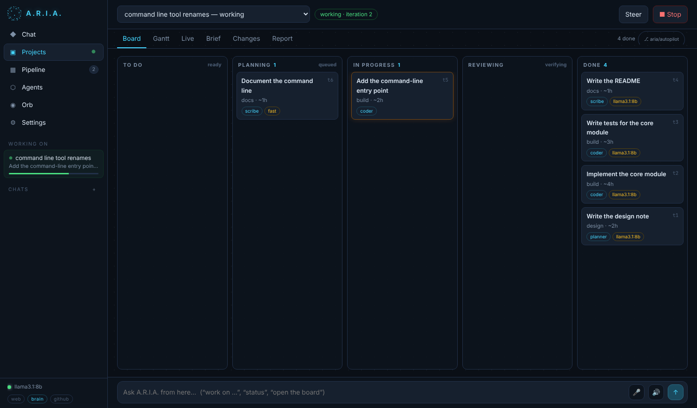

Pick a project, approve its plan, press Start. The bar at the top always
says where the project lives on your disk.

- **Board** — To Do · Planning · In Progress · Reviewing · Done. Every
  card shows the agent, model and skills the plan gave it, and how long
  it took. Older finished work folds away; "Show earlier" brings it back.
- **Gantt** — everything the project ever planned, in measured time: a
  finished bar is as long as the task took, and work not done yet is
  predicted from the pace measured so far in this project. Dependencies
  are arrows; older batches fold into one line each.

  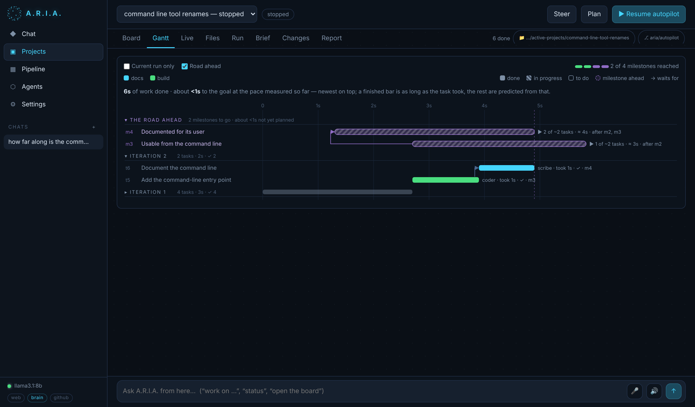

- **Live** — what she is doing this minute, streamed as she thinks, beside
  the activity log.

  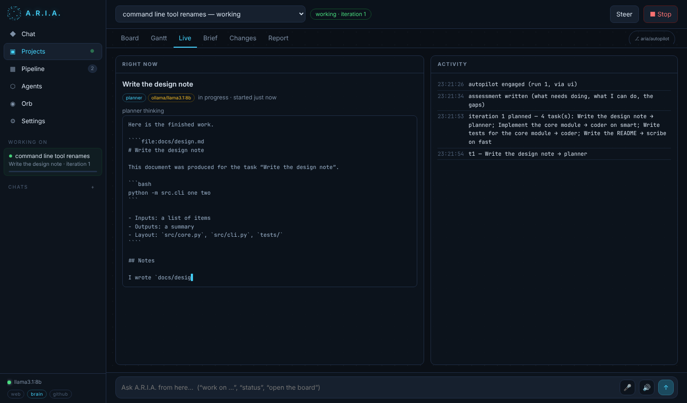

- **Files** — the project's folder: every file, viewable, with the task
  that last changed it. Copy path, **Open folder**, **Open in editor**,
  **Terminal here**. Wherever she names a file — in a report, a change, a
  chat reply — it is a link to it.

  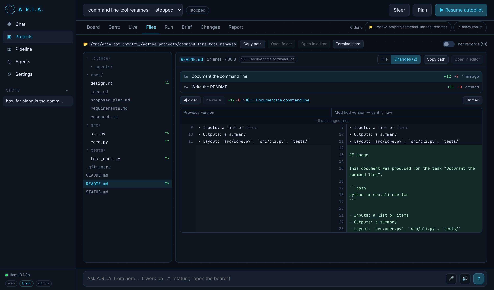

- **Run** — try the software yourself. How to start it is worked out from
  what is in the folder; the command is shown and starts when *you* press
  Run. Output streams back, a local address becomes an Open button, and
  with bubblewrap installed it can change files only inside its own
  folder. "Run the tests" does what she does after every change.

  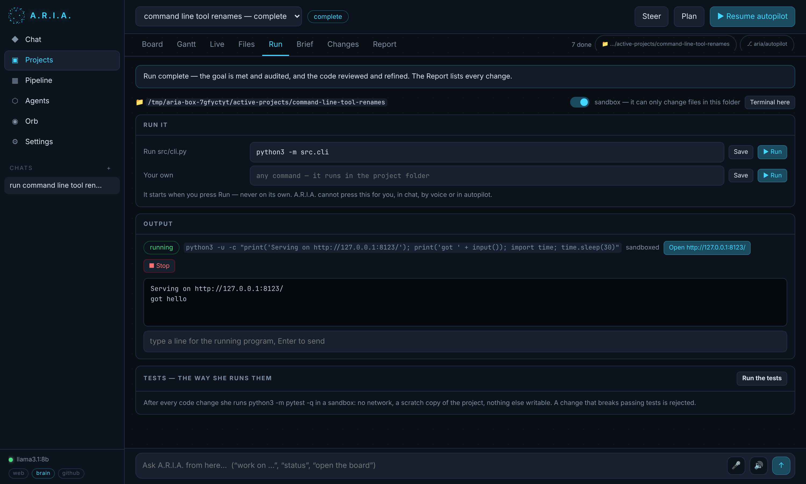

- **Brief** — the assessment she wrote before planning (what needs doing,
  what she can do with what she has, the gaps), her working memory, her
  code review, and your guidance.
- **Changes** — every completed task: files touched, why, how it was
  verified, what the tests said, references.

  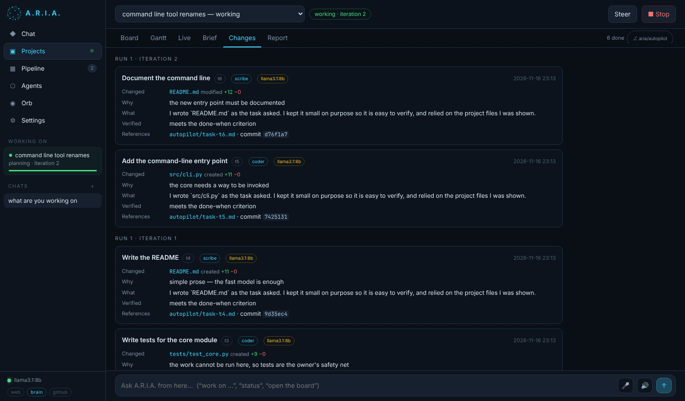

- **Report** — the final report of every run, newest first.

**Steer** gives her guidance without stopping; **Stop** lets her finish
the step in flight and write the report. A task that is yours to decide —
spending money, a choice that cannot be undone — is marked **needs you**
and waits for your answer while the rest carries on. The full story:
**[docs/AUTOPILOT.md](docs/AUTOPILOT.md)**.

### Pipeline — watch an idea become a plan

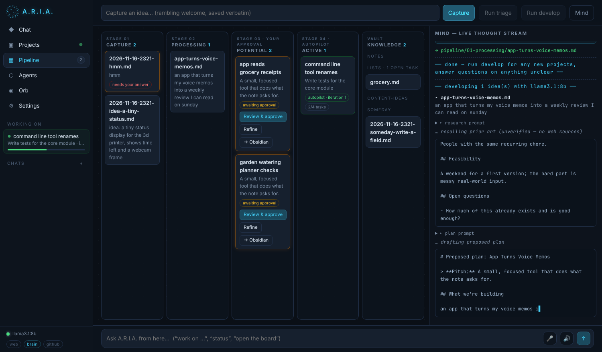

The five stages of an idea's journey, with anything that needs you glowing
amber. Capture from the bar at the top; with `auto_pipeline` on (the
default) a new idea is triaged, researched and planned straight away. The
**Mind** panel opens while she works and shows the exact prompt, the
model's output token by token, each decision with its confidence, and
every file move — including runs you started from chat or by voice.

Every card under Potential has **Review & approve** (opens the plan in
Projects), **Refine**, and **→ Obsidian**.

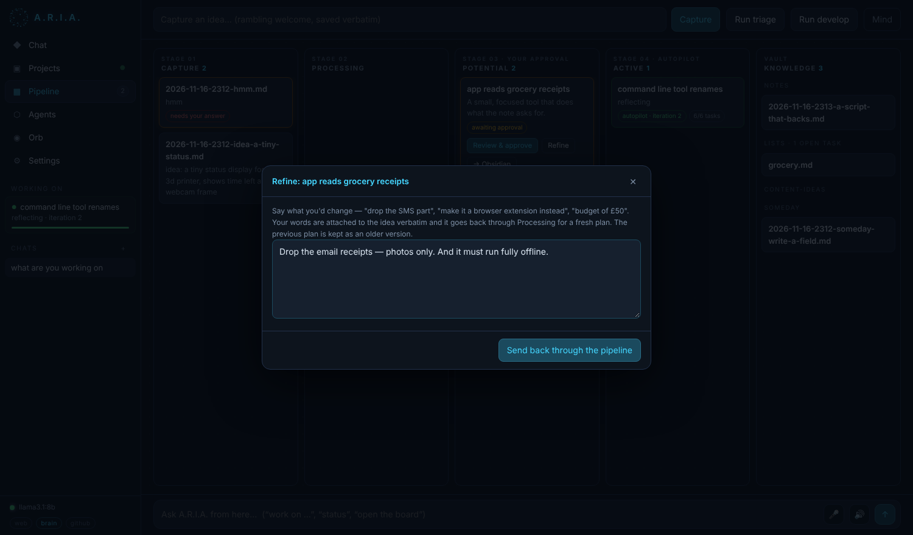

*Refine* sends an idea back through the pipeline with your feedback
attached verbatim ("drop the SMS part", "must run fully offline"): the
current plan and research are kept as numbered versions, and the next plan
treats your words as binding.

### Agents — the team and the library

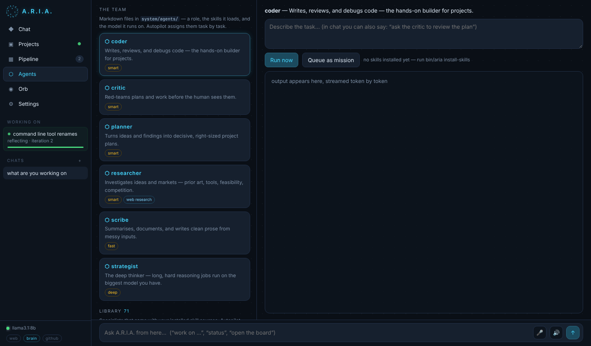

Agents are markdown files in `system/agents/`: a **role**, the **skills**
it loads, the **model** it runs on (a tier, or a specific model), and
whether it gets live web research. Six ship by default — `planner`,
`coder`, `researcher`, `critic`, `scribe`, `strategist` — and adding one
is dropping another file in the folder.

Below them is the **library**: specialists that arrive with the skill
sources you install (ECC brings about seventy — language reviewers,
build-fixers, architects, an SEO specialist…). Autopilot offers the
planner the ones that fit each project. Run any agent by hand from this
page, from chat ("ask the critic to…"), or queue it as a background
**mission** that keeps running with every tab closed.

### Orb — voice

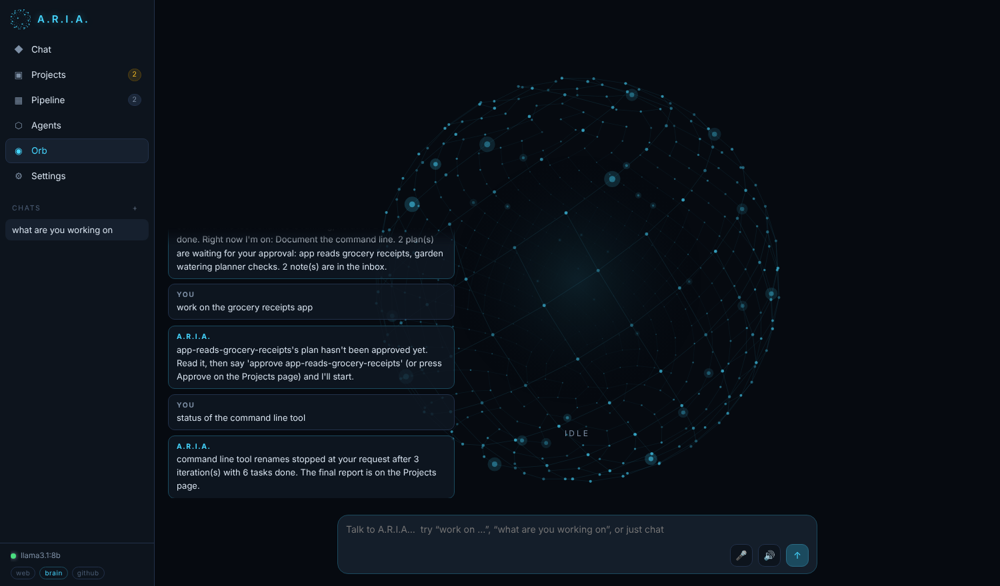

The same conversation as Chat, as a presence: idle, listening, thinking,
speaking.

- **Voice in** — click the mic and talk. Chrome transcribes natively;
  other browsers (**Firefox**) record and transcribe **locally** through
  faster-whisper (`pip install faster-whisper`, model set by
  `aria.stt_model`).
- **Voice out** — replies are spoken by your system's speech synthesis;
  🔊 mutes her.
- **From an Echo** — see [docs/ALEXA.md](docs/ALEXA.md).

### Settings

Models, internet, the Obsidian brain, Git & GitHub and autopilot's
behaviour, without touching YAML. What you save goes into
`system/config.local.yml` — your own file, which updates never touch;
`system/config.yml` keeps the defaults and explains every key.

## What she can reach

Each is one switch, and each has a boundary that holds whatever a model
says. Details and reasoning: **[docs/INTEGRATIONS.md](docs/INTEGRATIONS.md)**.

| Reach | Switch | What it gives her | What she cannot do |
|---|---|---|---|
| **The internet** | `web_access` (on) | Search and page reading in chat and by voice; sourced research for new ideas and for autopilot tasks | Touch your local network; anything but read |
| **Git** | `autopilot_git` (on) | A commit per verified task, on `aria/autopilot`, when a project is its own repository | Commit to your base branch; stage files she did not write |
| **GitHub** | `github_access` (off) | A private repo per project, the branch pushed, a pull request kept open | Push to the base branch; force anything; merge |
| **Obsidian** | `obsidian_vault` (unset) | Project hubs, dictated notes, saved research, a daily journal | Write outside `<vault>/ARIA/` |
| **Running code** | `autopilot_checks` (sandbox) | The project's own tests after every change, in a sandbox; a change that breaks them is rolled back | Use the network, read your home folder or write outside a scratch copy while testing; start a program — only you do that, in the Run tab |
| **Your desktop** | — | Open a project's folder, editor or a terminal on your click; a notification when she needs you or a run ends | Open anything but a project's own folder; hand a file to "whatever opens this type" |
| **Giant models** | `giant_general` … (unset) | Your largest models, one role each, loaded when a task needs them and swapped so only one is in memory | Unload one mid-answer; use one that is still downloading |
| **Alexa** | `aria voice-gateway` | Everything above, by voice, from any Echo | Approve a plan, answer a task that waits on you, or push to GitHub by voice |
| **Webhooks** | `webhooks:` (none) | n8n flows, Home Assistant, deploy hooks — "trigger deploy-site" | Reach any URL you did not name |

With `web_access` on, search queries leave your machine; everything else
stays local. Turn it off and she says plainly that she cannot browse.

## Skills and specialists

```bash
bin/aria install-skills    # clone every source in system/skill-sources.txt
bin/aria skills convert    # build the universal pack in skills/
bin/aria skills prompt docx | wl-copy   # paste a skill into any other AI
```

Sources are git repos listed in `system/skill-sources.txt`: Anthropic's
official skills, prompt-master, the Karpathy coding guidelines, 53
marketing skills, and **[ECC](https://github.com/affaan-m/ecc)** — about
330 engineering skills and 70 specialist agents. ECC is marked
`engine-only`: A.R.I.A.'s own agents and autopilot use it, while Claude
Code sessions in this repo are not handed hundreds of extra skills (for
Claude Code, install ECC as a plugin instead).

Nothing is loaded wholesale. For each project the planner is offered the
skills and specialists that fit its goal, and a task loads at most a few.
The converter also makes every skill usable outside A.R.I.A.: each becomes
`skills/<name>/PROMPT.md` plus a manifest, for any model that takes a
system prompt. Skills that rely on bundled scripts (docx, pdf, pptx…)
are marked `requires-code-execution` — her agents can follow their
guidance but cannot run the scripts.

### Models — fast, smart, and deep tiers

Every stage picks a tier from your settings (⚙ Settings, or
`aria settings set smart …`):
**fast** (triage, chat), **smart** (plans, agents), **deep** (optional
heavy thinker; agents opt in with `model: deep`). Each tier is
`backend/model`, where a backend is Ollama or any OpenAI-compatible server.
On a 16GB-VRAM / 64GB-RAM box, the private-and-local upgrade path:

```bash
ollama pull qwen3:30b        # MoE ~30B: near-70B quality, fast   -> smart
ollama pull gpt-oss:120b     # ~117B MoE, slow but deep           -> deep
bin/aria llama install       # optional: llama.cpp Vulkan (fastest on AMD)
```

MoE models keep attention on the GPU and park expert weights in system
RAM (`--n-cpu-moe` — presets in `bin/aria-llama serve smart|deep`), which
is what makes 30B fast and ~120B possible on this hardware.

**Giants — one role each.** Larger-than-RAM models (671B and 1T-class,
streamed from NVMe at about a word a second) get a role: `general`,
`research`, `coder`.

```bash
bin/aria models scan
```

finds the GGUF files you have downloaded and prints the command that
gives each its role (or: Settings → Giant models). From then on she
starts the right one when a task needs it and unloads the others first —
only one is in memory at a time — runs what the loaded one can do before
swapping, and leaves out a model that is still downloading until every
part is there. Whether a task gets a giant is hers to judge
(`giants_use: auto`): she is told what they cost, and keeps planning and
reviewing on your everyday tiers. The whole setup:
**[docs/MODEL-GARAGE.md](docs/MODEL-GARAGE.md)**; how such models run at
all: **[docs/BIG-MODELS.md](docs/BIG-MODELS.md)**.

### Engines: local models vs Claude

`bin/aria triage`, `develop` and `auto` run on the `engine` setting
(`aria settings set engine claude`):

| | `ollama` (default) | `claude` |
|---|---|---|
| Runs on | your local model server | headless Claude Code (`claude -p`) |
| Cost / privacy | free; only web searches leave your machine, and only if `web_access` is on | API usage |
| Triage | ✅ works well on small models | ✅ |
| Develop | ✅ researched on the live web with sources — or, with web access off, a draft from recall, labelled unverified | ✅ web research with sources |
| Approve → execute | ✅ approve in the app, then autopilot | ✅ `/approve`, `/promote-project`, then the project's PM |

The engines are interchangeable per run: `ARIA_ENGINE=claude bin/aria develop`
re-does a stage. Slash commands inside a Claude Code session always use
Claude. `bin/aria doctor` checks that your model server is reachable and
which reaches are switched on.

## Life after approval

An approved project is **a directory that is its own workspace** — and,
when it lives outside this repo, its own git repository. Two things can
work it, and they share the same files:

- **Autopilot**, on your local models: `work on <project>`. It keeps
  `STATUS.md` current, commits each verified task, and leaves its plan,
  memory, changes and reports in `autopilot/`.
- **A Claude Code project manager**: the project's `CLAUDE.md` knows the
  requirements and delegates to project-specific subagents.

  ```bash
  cd active-projects/<slug>
  claude
  > begin execution          # PM works the milestone plan
  > status report            # progress, blockers, next steps
  ```

By default projects are promoted to `active-projects/` inside this repo.
Point the `promotion_target` setting at e.g. `~/Projects` to give
each one its own repository — that is what switches on a commit per task
and lets `aria github publish` put it on GitHub.

To put a codebase she did not create under autopilot:
`bin/aria adopt <git-url | owner/repo | folder> "what you want done"`.

## Layout

```
aria/
├── CLAUDE.md                  # A.R.I.A.'s operating manual (read by Claude Code)
├── .claude/                   # slash commands, the pipeline subagents, settings
├── system/
│   ├── config.yml             # every setting, explained — the defaults
│   ├── config.local.yml       # your own values (ignored by git; they win)
│   ├── agents/                # her standing team (markdown)
│   ├── skill-sources.txt      # where skills and library agents come from
│   └── templates/             # idea note, plan, requirements, PM, subagent, status
├── pipeline/
│   ├── 00-inbox/              # raw captures land here
│   ├── 01-processing/         # classified as "project", awaiting a plan
│   ├── 02-potential-projects/ # proposed plans awaiting YOUR approval
│   ├── knowledge/             # everything that wasn't a project
│   ├── archive/               # processed inbox originals
│   └── LEDGER.md              # every idea's journey through the stages
├── active-projects/           # default promotion target (configurable)
├── bin/
│   ├── aria                   # the command line
│   ├── aria_engine.py         # config, model client, pipeline, chat, agents
│   ├── aria_autopilot.py      # the autonomous loop
│   ├── aria_web.py  aria_brain.py  aria_git.py   # her reaches
│   ├── aria-ui                # the app's server
│   ├── aria-voice-gateway     # the door for Alexa
│   └── aria-test  aria-mock-llm                  # the self-test and its stand-in model
├── ui/                        # the app: one shell, six views
├── integrations/alexa/        # skill model + Lambda
└── docs/                      # autopilot, integrations, Alexa, models, roadmap
```

Everything is the Python standard library and plain JavaScript — nothing
to `pip install` or build.

## More

- **[docs/AUTOPILOT.md](docs/AUTOPILOT.md)** — the loop, the report, what
  happens when things go wrong, and its honest limits.
- **[docs/INTEGRATIONS.md](docs/INTEGRATIONS.md)** — every reach and its
  boundary; the wider ecosystem (n8n, Uptime Kuma, OpenHands, ECC…).
- **[docs/ALEXA.md](docs/ALEXA.md)** — voice from an Echo.
- **[docs/ROADMAP.md](docs/ROADMAP.md)** — what helps an agent that runs
  on its own for days: what is in place, and what would help most next.
- **[docs/BIG-MODELS.md](docs/BIG-MODELS.md)**,
  **[docs/MODEL-GARAGE.md](docs/MODEL-GARAGE.md)**,
  **[docs/UPGRADE-CHECKLIST.md](docs/UPGRADE-CHECKLIST.md)** — models.

## Design notes & prior art

- **[open-jarvis/OpenJarvis](https://github.com/open-jarvis/OpenJarvis)** —
  borrowed its execution-mode taxonomy: *on-demand* agents (the slash
  commands), *scheduled* agents (`bin/aria` + cron), and *continuous* agents
  (the PM that lives with a project). Its orchestrator→specialist pattern is
  mirrored in `/promote-project`'s PM + subagent scaffold.
- **[garrytan/gbrain](https://github.com/garrytan/gbrain)** — borrowed its
  signal pipeline shape (capture → classify → enrich → background
  maintenance) and its "schema packs" idea: every note here carries typed
  YAML frontmatter so automation can route it without guessing. Its overnight
  "dream cycle" is the model for the cron examples above. If A.R.I.A.
  outgrows folders-as-database, GBrain is the natural memory backend
  (it speaks MCP, so Claude Code can plug straight into it).
- **[eugeniughelbur/obsidian-second-brain](https://github.com/eugeniughelbur/obsidian-second-brain)** —
  the closest existing implementation of this workflow (inbox triage, idea
  "graduation" into specs, scheduled vault maintenance). Worth mining for
  extra commands; A.R.I.A.'s vault stays Obsidian-compatible on purpose.
- **[VoltAgent/awesome-claude-code-subagents](https://github.com/VoltAgent/awesome-claude-code-subagents)**
  and **[wshobson/commands](https://github.com/wshobson/commands)** — pattern
  libraries the PM can raid when it designs a project's subagent team.

## Guardrails

1. **Nothing is ever deleted** — inbox originals are archived, old plans
   are kept as versions, every run's report is kept.
2. **Nothing is executed without your approval** — `requirements.md` with
   `approved: true` is written only by an explicit act of yours (the
   Approve button, saying or typing "approve …", `aria approve`, or
   `/approve` in Claude Code). Autopilot refuses anything else, and a
   voice assistant cannot approve. Inside a run, a task marked as yours
   to decide waits for your answer in the same way.
3. **Triage never guesses** — items it can't classify are marked
   `type: unclear` with clarifying questions, and wait for you.
4. **Only verified work stays** — a rejected attempt is rolled back; the
   approved requirements and her own records cannot be overwritten by an
   agent. A change that breaks the project's own tests is a rejected
   attempt.
5. **She says what she cannot do** — no web access means "I can't browse",
   not an invented answer; a report opens by saying whether its changes
   were tested by running them or not.
6. **Code she wrote is never trusted with your machine** — her tests of it
   run in a sandbox with no network and nothing writable but a scratch
   copy; a program is only ever started by you.
7. **Only this machine talks to her** — the server answers 127.0.0.1 and
   refuses requests a web page elsewhere could send it.
