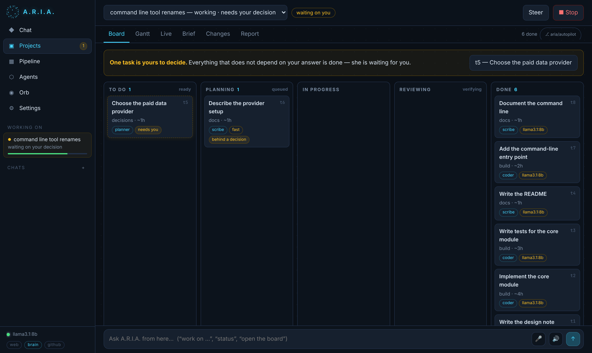
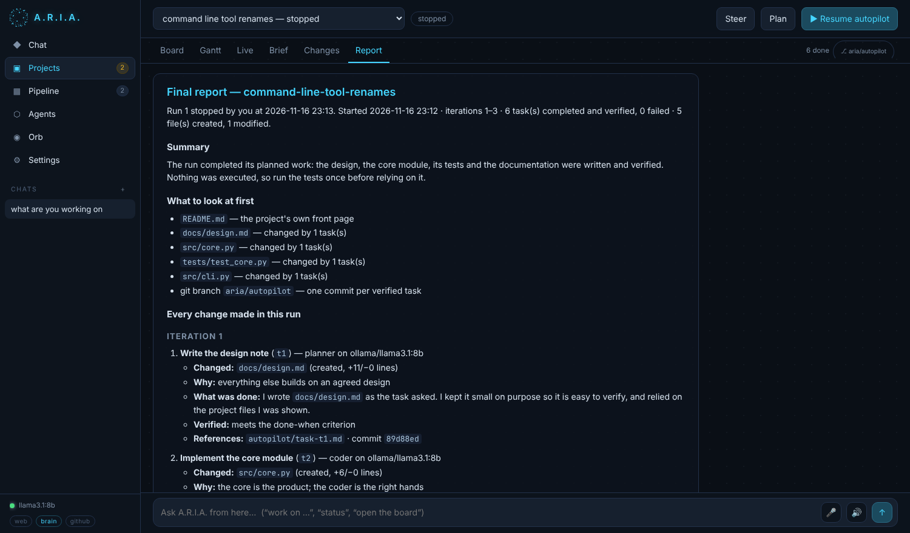

# Autopilot — she works the project, you sleep

Say **`work on <project>`** (chat or voice), press **▶ Start** on the
Projects page, or run `aria autopilot <slug> start` — then walk away. She
keeps going, batch after batch, until you tell her to stop.

## The one thing that needs you

Autopilot will not touch a plan nobody approved. **Approve** it — the
button on the Projects page, "approve *project*" in chat, or
`aria approve <slug>` — and the proposed plan, exactly as it stands,
becomes `requirements.md`. The project then moves out of the pipeline into
its own workspace (`active-projects/<slug>/`, or wherever
`promotion_target` points) and work begins. Everything after that is hers.

## The loop

```
assess → map the road → plan → [ execute → verify → record ]* → reflect → plan → …
                                              goal met → audit → review & refine → improve → …
```

1. **Assess.** Before planning anything she takes stock and writes
   `ASSESSMENT.md`: what needs to be done, which of the agents, skills,
   models and tools on hand cover which part, what they *cannot* do, and
   the order of attack.
2. **Map the road.** Before the first batch she lays out the *whole* way
   from where the project is to its goal, as milestones — see [The road
   to the goal](#the-road-to-the-goal). Every plan after that is drawn
   against it.
3. **Plan.** A batch of 3–8 tasks towards the earliest milestones that
   can be worked on. Each names the **milestone** it serves, its
   **agent** (the standing team, or a library specialist that fits this
   project), the **skills** it should load, the **model** it needs (a
   tier, a specific installed model, or one of your
   [giants](MODEL-GARAGE.md) by its role), whether it is **hard** — the
   few tasks an everyday model is likely to get wrong, which go to a
   giant — the files it must read, what it depends on, *why* it exists,
   and an observable `done_when`. A task that turns on something only you
   can decide is marked as **yours** — see [When a decision is
   yours](#when-a-decision-is-yours).
4. **Execute.** One task at a time, in dependency order. The agent sees
   the goal, the project memory, the files it asked for and its
   dependencies' output, and answers with whole files in `file:` blocks.
   Tasks marked *research* get live web material with sources attached.
5. **Verify.** Three things, in this order. Mechanically — does the
   Python, JSON, shell or JavaScript even parse? Then **the project's own
   tests, run in a sandbox** ([below](#she-runs-the-tests)): a change that
   turns passing tests into failing ones goes no further. Then a judge
   reads the work against the task's own `done_when`, with the test result
   in front of it. A rejected attempt is **rolled back** and retried with
   the critique — for broken tests, the failing output itself. A task
   sent back twice on an everyday model gets its last attempt on the
   giant that fits the work, if you have one; after three attempts the
   task is marked failed and the planner routes around it.
   So every change left in the project passed verification.
6. **Record.** A structured entry in `changes.jsonl`, a readable one in
   `CHANGELOG.md`, and — when the project is its own git repository — a
   commit on the `aria/autopilot` branch.
7. **Reflect.** When a batch has nothing left to run, `MEMORY.md` is
   rewritten: the state of the project, decisions made, lessons, what is
   still to do. The next plan starts from that, not from a transcript that
   grows without end.
8. **Repeat.** When the planner says the goal is met, an **audit** checks
   that claim against the requirements; any gaps become the next batch.
9. **Review and refine.** With the goal met and audited she reads the
   whole codebase and refines it without changing what it does
   ([below](#review-and-refine)). Then she moves on to improvements and
   keeps going until you stop her (set `autopilot_after_goal: stop` to
   have her write the report and stand down instead).

## The road to the goal

A batch is three to eight tasks; a real project is many batches. So that
each batch is a step on a known road rather than the next thing that came
to mind, she first writes the road down: `ROADMAP.md` (and
`roadmap.json`), four to twelve **milestones** from where the project is
now to the goal itself.

A milestone is an outcome, not an activity — "receipts parse into
structured items", not "work on the parser" — and carries what must exist
for it to count as reached, which earlier milestones it cannot start
without, and roughly how many tasks it will take.

- **Every plan is drawn against it.** The planner is shown the whole road
  with what is reached, in hand and ahead, plans the work of the earliest
  milestones whose dependencies are met, and says which milestones its
  results have now reached. Every task belongs to one.
- **Every task is told where it fits**: which milestone it serves, what
  that milestone means, and what comes after it — so the agent writing
  one file knows what the file is for.
- **It is redrawn when the ground moves.** Your steering, or an audit
  that finds gaps, has her draw the road again from where things stand.
  A milestone that survives keeps its number, so the history on the
  Gantt still lines up.
- **You can see it and ask about it.** On the Gantt it is the band above
  the tasks; in chat or by voice, "how far along is *project*" and
  "what's left on *project*" are answered straight from it.

The final report lists the road — what is reached, in hand and still
ahead — and `STATUS.md` carries the count.

## Watching it

The **Projects** page:

- **Board** — To Do · Planning · In Progress · Reviewing · Done. Each card
  shows its agent, model and skills, and how long it took. Finished work
  beyond the newest forty folds away — "Show earlier" brings it back.
- **Gantt** — the newest work at the top, in measured time. A finished
  bar is as long as the task really took; work not done yet is predicted
  from what this machine has measured — not from the planner's guess
  ([how](#how-long-will-it-take)). The line above the chart gives the
  estimate, the slow case, and what both rest on. Dependencies are
  arrows; older batches fold into one line each and open on a click.
  Above the tasks, **the road ahead**: the milestones not yet reached,
  with an arrow from each one it waits for; click one for what "reached"
  means, what it unlocks, and its tasks. **Current run only** hides the
  earlier runs; **Road ahead** hides the milestones.
- **Live** — what she is doing right now, streamed as she thinks, beside
  the activity log. The arrows beside **Right now** step back through
  her earlier outputs, each in full with what it was for, when it
  finished and how long it took.
- **Files** — the project's folder: every file, with the task that last
  changed it. **Changes** shows each verified change to the open file as
  the previous version beside the modified one. Open the folder, your
  editor, or a terminal there.
- **Run** — start the software yourself, and run its tests the way she
  does.
- **Brief** — her assessment, her memory, her code review, your guidance,
  and the source documents.
- **Business** — the business plan beside who does what: your part (only
  you tick it), her part, and what a complete proposal still needs
  ([below](#your-part-of-the-work)).
- **Changes** — every completed task: the files it touched, why it was
  done, how it was verified, what the tests said, and what it drew on.
- **Report** — every run's final report, newest first.

Wherever she names a file — a report, a change, her memory, a chat reply
— it is a link: one click shows it, another opens it in your editor.

The sidebar shows what she is working on from every page, and you can ask
from anywhere: "what are you working on", "status of *project*", "how
far along is *project*", "what needs me", "what changed in *project*".
Those are answered from her records, not by a model, so they come back
at once however busy the models are.

## How long will it take

A planner asked for hours guesses at a person's effort on an ideal
system, and looks only at the work itself — which is how plans come out
short everywhere, not only here. So her estimates do not come from the
plan. They come from **what this machine has actually done**, kept in
`system/pace.json`:

- **Every finished task**, with all its attempts and its verification:
  how long, on which model, by which agent, and whether it passed.
- **Everything that is not a task** — the assessment, the roadmap, each
  plan, the memory rewrite, the audits and reviews. That time is in no
  task and is spent all the same; it is shared out per task.
- **How many tasks a milestone really took**, against the number the
  planner gave it, each time one is reached.
- **How often work is sent back** and has to be planned again.

From those, a task that has not run yet is expected to take what similar
tasks took: this project's own on the same model once there are three;
before that, everything this machine has measured on that model; before
that, on the same kind of model — a giant is never estimated from an
everyday model. Only on a machine with no record at all is it a first
guess, and it says so: seven minutes for an everyday model, an hour for
a giant, deliberately not optimistic. It corrects itself as tasks
finish.

The road ahead is counted the same way: the tasks a milestone was given,
times how far such counts have run over before, times the share that
gets redone — plus the planning around each. What you see is two
figures: the **typical** case and an **ordinary bad day** (the time four
tasks in five come in under), with what they rest on — "from this
project's own 14 finished tasks", "from 212 tasks measured on this
machine", or "a first guess".

It shows above the Gantt, beside each milestone ahead, and in the answer
to "how far along is *project*" — in chat, by voice, or
`aria autopilot <slug> status`.

Two things it is not. It is **working time**: hours spent waiting for
your decision, or for a model server that was away, are not in it — and
it does not know when the machine will be on. And it is an estimate of a
road that gets redrawn: steer her, or let an audit find gaps, and the
figure moves with the road.

## Steering without stopping

**Steer** (Projects page), "tell *project* to …" in chat, or
`aria autopilot <slug> steer "…"`. Guidance is binding on every plan from
then on; work that has not started is replanned around it, and nothing
that is running is interrupted.

## She runs the tests

After every change to code, the project's own tests are run — `pytest`
where the project's Python has it, a small built-in runner for plain test
functions otherwise, `npm test`, `cargo test`, `go test`, `make test`.
What they say decides:

| Before the change | After it | What happens |
|---|---|---|
| passing, or no tests yet | passing | on to the judge, who is told so |
| passing, or no tests yet | **failing** | rejected and rolled back; the test output is the critique for the retry |
| already failing | still failing | not held against this task; the judge is told |
| already failing | passing | good — and from now on a failure is a regression |

This is code a model wrote, so it is run **without being trusted**
(bubblewrap):

- no network at all — not the internet, not this machine's own servers;
- the machine is read-only; your home folder, other drives and `/run`
  (D-Bus, the display, Docker: each a way out) are not there at all,
  apart from the toolchains needed to run anything;
- a scratch copy of the project is the only place it can write, and it
  is thrown away afterwards — a test that deletes "the project" deletes
  a copy;
- none of A.R.I.A.'s keys or tokens are in its environment;
- a time limit (`autopilot_check_seconds`, 300), and a ceiling on memory
  and on the number of processes where systemd provides one.

```bash
sudo pacman -S bubblewrap
```

Without bubblewrap **nothing is executed** — every change is checked by
parsing and by the reviewing model only, and the final report opens by
saying exactly that. `autopilot_checks: direct` runs the tests without a
sandbox (in a scratch copy, with your permissions — your call); `off`
never runs them. `aria check <slug>` and the Run tab's **Run the tests**
do the same thing on request, so you can see what she sees.

Tests cannot install packages or reach the network; the planner is told
to keep them self-contained and quick.

## Review and refine

When the goal is met and audited — and again after every eight further
changes, or whenever you ask — she reviews the code:

1. **Reads every source file**, one reviewer call each, and writes
   `REVIEW.md`: what is worth changing, file by file — bugs, dead code,
   duplication, needless complexity, slow paths, missing error handling —
   each marked safe or careful, with what became of it. Earlier reviews
   are kept in `reviews/`.
2. **Plans one refinement per file**, most serious first, up to eight a
   pass.
3. **Makes them under a stricter rule.** A refinement must not change
   what the code does. Its judge is shown the change as a diff and told to
   fail it if anything a user or a caller could observe may differ — and
   the project's tests are run on it. Anything else is rolled back.

Ask for a pass any time: **Review & refine now** on the Brief tab, "refine
*project*" in chat, or

```bash
aria autopilot <slug> refine
```

`autopilot_refine: false` turns the automatic pass off. The reviewer is
the `critic` agent's model; give it a stronger one in
`system/agents/critic.md` for a harder review.

How much this can promise depends on the tests. With tests that cover
the behaviour, "without changing what it does" is checked by running
them. Without tests it rests on a model reading a diff — the report says
which it was.

## Running it yourself

The **Run** tab starts the software on this machine, in the project's
folder, when *you* press Run. How to start it is worked out from what is
there (a Python entry point, `npm start`, `cargo run`, a Makefile, a
static page) or typed in — **Save** keeps your own command for the
project. The exact command is shown before its first run. Output streams
back, a line you type reaches the program, a local address it prints
becomes an **Open** button, **Stop** stops it.

With bubblewrap the program can change files only inside the project
folder (it can still read your files and use the network — it is your
software, being tried out). Untick the switch to run it plainly.

Nothing but your click starts a program: not chat ("run *project*" opens
the tab and says so), not a voice, not autopilot. In a terminal:

```bash
aria run <slug>
```

lists the ways to start it; add the number of one to start it there.

## When a decision is yours

Some things are not hers to decide: spending money, a choice that cannot
be undone, an account only you hold. The planner marks such a task
**needs you**. It stays in To Do — amber, dashed — and so does anything
that builds on it. Everything else carries on, batch after batch. Only
when nothing else is left does she stop and wait, and waiting costs
nothing: no model is called until you answer.



Open the task and answer it:

- **Approve** — add your decision if the task needs one ("use the free
  tier", "call it Larder") and the task is told to follow it exactly.
- **Skip it** — it is not attempted, what built on it is dropped, and she
  plans around it.

The same from chat — "approve task t5 in *project*: use the free tier",
"skip task t5 in *project*" — or from a terminal:

```bash
aria autopilot <slug> approve-task t5 "use the free tier"
```

```bash
aria autopilot <slug> skip-task t5 "no budget for this"
```

Your answer is recorded with the change it led to, in the changelog and
in the final report. A voice assistant cannot give it for you. If you
named a `mission-done` webhook she calls it when a task starts waiting
on you and again when she has run out of other work.

## Your part of the work

A task that *needs you* is a decision. Some work is yours in a different
way: nobody but a person can do it at all — talk to five people who have
the problem, choose the name, open the account, register, sign. When she
writes a project's business plan she splits what is left into two lists
(`docs/action-list.md`):

- **Her part** — what can be researched, drafted, calculated or built.
  On approval it joins `requirements.md`, and autopilot does it like any
  other requirement; the documents it produces go under `business/`.
- **Your part** — each item with why it is yours and what she can
  prepare so that it is short: the interview questions, the shortlist of
  names with the free domains, what each legal form would mean.

Your list is in the **Business** tab, in "what's on my list" (chat or
voice) and in `aria mylist`; "what needs me" counts it. Tick an item when
you have done it — in the tab, with "done y2 in *project*", or:

```bash
aria done <slug> y2
```

She never ticks one, never moves one to her own list to get it done,
and never plans a task that does it for you: the planner is told the
list is yours, and the files that hold it are among those no task may
write. `aria business <slug>` (or **Write it again**) redrafts the plan
and both lists and keeps your ticks. What the business plan asks, and
why: [PROJECT-GROUNDWORK.md](PROJECT-GROUNDWORK.md).

## Stopping, and the report

"stop working on *project*", **■ Stop**, or `aria autopilot <slug> stop`:
the step in flight finishes, the final report is written, and the project
is left exactly as it is.

`FINAL-REPORT.md` is built from the structured record, not from a model's
recollection, so it is complete however long the run was. For every
change: the files (created or modified, lines added and removed), why the
task existed, what was done, how it was verified, and its references —
the task's full output, the commit, and any web sources. Failed tasks are
listed with the reason; nothing from them is left in the project. Tasks
still waiting on your decision are listed too, with what waits behind
them. Earlier runs' reports are kept in `autopilot/reports/`.



Starting again later is a new run that carries on from the same plan and
memory.

## When things go wrong

| What happens | What she does |
|---|---|
| The model server is down or drops the connection | Waits and retries with a growing pause (30 s up to 15 min). The task is not counted as failed and nothing is lost. |
| A model stays silent | Fast and smart tiers are abandoned after `autopilot_idle_minutes` and retried. The deep tier and hand-picked models are never cut off. |
| Work is rejected | Rolled back, retried with the reviewer's critique; failed after three attempts. Tasks that depended on it are skipped and the planner is told why. |
| A model reasons until its window is full, and its answer is cut off | She asks again for the answer alone, and says so in the log. |
| A reply is cut off all the same — the window is too small for it | A task's attempt is rolled back and retried with "write less"; a plan stops the step with the reason and the remedy (a larger `context_tokens`). Nothing half-written is kept. |
| A step fails for any other reason | The reason is written in the log and on the project's status line, and the step is tried again after a pause that grows (30 s up to 15 min). Five failures in a row and she pauses herself, saying why. |
| Work is rejected twice on an everyday model | The last attempt goes to the giant that fits the work (unless `giants_use: never`, or you have none). The card says why it moved. |
| A change breaks tests that passed | Rejected like any other, with the failing test output as the critique. |
| A giant model is still downloading, or fails to load | The task runs on the smart tier instead and says so; the giant joins in once its files are complete. New tasks go to the next giant that fits — with no coder giant set up, hard coding work goes to the general one. |
| `autopilot_stall_limit` batches in a row (3 unless you change it) complete nothing, or the planner keeps returning nothing | She pauses herself ("stalled"), writes the report and says why. |
| The planner proposes work that is already done, that you declined, or that has failed twice | It is left out of the plan, and the log says so. |
| The server restarts mid-task | The task is picked up again on the next step. |
| A budget is reached (`autopilot_max_hours`, `autopilot_max_tasks`, `autopilot_max_iterations`) | Finishes the step in flight, writes the report and pauses as "budget reached". Resuming is a new run with a fresh budget. |
| A decision is yours to make | The task waits; the rest carries on. See [above](#when-a-decision-is-yours). |

However a run ends — stopped, complete, stalled, budget reached — she
writes the report and calls the `mission-done` webhook if you named one.

## Git and GitHub

When a project is its own repository — it is when `promotion_target` is
outside the A.R.I.A. repo, or after `aria github init <slug>` — every
verified task is one commit on `aria/autopilot`. Your base branch is never
committed to, and only the files a task wrote are staged: your own
uncommitted edits in the same tree are left alone.

With `github_access: true`, `aria github publish <slug>` creates a private
repository, and at the end of each run she pushes the branch and opens (or
updates) a pull request. See [INTEGRATIONS.md](INTEGRATIONS.md).

## A codebase she did not create

```bash
aria adopt https://github.com/you/your-repo "Add a command line entry point and document it."
```

```bash
aria autopilot your-repo start
```

`adopt` takes a git URL, a GitHub `owner/repo`, or a folder on this
machine. The goal you state is the contract — stating it is the approval.
Her records go in a hidden `.aria/` folder that git is told to ignore, so
the repository only ever receives the verified work.

## What is on disk

Under `<project>/autopilot/` (`.aria/` for an adopted codebase):

| File | What it is |
|---|---|
| `ASSESSMENT.md` | the stock-take written before the first plan |
| `ROADMAP.md`, `roadmap.json` | the road to the goal: the milestones, what each waits for, which are reached |
| `plan.json` | the live task plan — the Board and the Gantt are drawn from it |
| `plan-archive.jsonl` | finished tasks that have left the board (still on the Gantt and under "Show earlier") |
| `MEMORY.md` | the working memory, rewritten after every batch (a project first run under the earlier autopilot has `lessons.md`; it is folded in at the first rewrite) |
| `STEERING.md` | your guidance |
| `STOP`, `STEER`, `decision-<id>.json` | your signals — stop, new guidance, an answer on a task that waits for you — picked up before her next step and then removed |
| `changes.jsonl` | the complete, structured change record |
| `CHANGELOG.md` | the same, readable |
| `task-<id>.md` | every attempt at every task, with its verdict |
| `versions/<task>/…` | each file as it was before a verified change — what the Files tab compares against (kept on this machine; git ignores it) |
| `live/` | her last forty finished outputs in full, for the Live tab's arrows (also kept out of git) |
| `REVIEW.md`, `reviews/` | the latest code review, and every earlier one |
| `FINAL-REPORT.md`, `reports/` | the latest report, and every earlier one |
| `run.json`, `run.log` | your own run commands for the project; the output of the last program you started |
| `state.json`, `activity.jsonl` | where she is, and the Live tab's feed (older entries move to `activity-archive.jsonl`) |

Beside it, in the project's `docs/`: `business-plan.md`,
`action-list.md` and `actions.json` (the same list as data — your ticks
live there). Machine-wide, in `system/`: `pace.json`, the measured times
every project's estimates are made from. It never leaves this machine.

## Where it runs

Inside the always-on server (`aria.service`), beside the mission worker —
closing every tab changes nothing. Without the server,
`aria autopilot <slug> run` works the project in a terminal. Autopilot
never blocks triage, chat or missions; it shares only the hardware.

## Tuning

- **Models decide the quality.** The planner, the verifier and the audit
  run on the smart tier; a sharper model there helps more than anywhere
  else. Give drafting to fast models and judgment to big ones.
- **`context_tokens`** (default 8192) is requested from Ollama for every
  call and prompts are sized to it. Ollama's own default silently cuts
  long prompts — raise this if your model and VRAM allow.
- **Models that reason first** (qwen3, deepseek-r1 and their kind think
  at length before they answer). The reasoning costs time, and it shares
  the window with the prompt and the answer: a plan reasoned about for
  two thousand tokens that then has no room to be written down is no
  plan. With `thinking: auto` (the default) chat, triage and summaries
  are asked for the answer alone, so they stay quick; plans, reviews and
  tasks on the smart tier reason only when the window has room for both
  — at 8192 that is the small calls, at `context_tokens: 16384` nearly
  all of them. The deep tier, models you name yourself and the giants
  are left alone. `always` leaves every model to itself; `never` asks
  for the answer alone everywhere. Her reasoning shows in the Live tab,
  marked off from her answer.
- **The model server is hers to start.** She starts Ollama when she
  starts, and again whenever a step finds it away (at most once a
  minute); the quick model is loaded at start, and the fast and smart
  models are kept in memory for `ollama_keep_alive` (default 30m) after
  each use, so the next task does not wait for a reload. A deep-tier
  model is left on Ollama's own five minutes, and a giant that needs
  the memory still gets all of it. Settings → Models, or
  `aria settings set ollama_keep_alive 2h`.
- **Budgets and the stall limit** (Settings → Autopilot) bound a run you
  leave for days: hours, batches, tasks, and how many batches may
  complete nothing before she pauses herself. All off or lenient by
  default.
- **Skills and specialists** come from `aria install-skills`. For each
  project the planner is offered only the ones that fit its goal.
- **Giants** ([MODEL-GARAGE.md](MODEL-GARAGE.md)): with `giants_use: auto`
  a giant gets the tasks the planner marks as hard, and the last attempt
  at anything an everyday model failed twice; `always` sends every
  coding task to the coder, research to the researcher and the rest to
  the general model — strongest, and slowest by far. Planning, review and
  memory stay on your everyday tiers either way. `bin/aria models test
  <role>` proves a giant loads before you rely on it.

## Honest limits

- She runs the project's **tests**, sandboxed, and nothing else. She does
  not start the program, click through it, or try it against real data —
  that is the Run tab, and you. Without bubblewrap she runs nothing at
  all, and the report says so. For an agent with a shell, pair autopilot
  with the OpenHands handoff (`aria handoff <slug>`) or the generated
  CrewAI crew.
- Tests prove what they test. A project with thin tests gets thin
  protection — the review pass will say so (`tests` findings), and
  writing them is a good thing to steer her towards.
- Tests that need the network, a database or packages that are not
  installed cannot run in the sandbox; they count as "already failing"
  and protect nothing.
- Files are rewritten whole, so very large files are expensive and risky
  to edit; small modules work best.
- The verifier is a model. It is only as sharp as your smart tier, and it
  can reject good work or accept weak work. Skim the Changes tab on long
  runs.
- Web research reads search results and a couple of pages per task. It
  cites what it used; it is not a deep-research system.
- Estimates are only as good as the record behind them. On a fresh
  machine they are a stated first guess; they become this machine's own
  after a handful of tasks, and a project unlike anything measured
  before will still surprise them.
- A business plan drafted by a local model is a list of leads, not
  findings: its figures are estimates to check, what it says about law
  and tax is a list of things to ask, and none of it is advice. It says
  where each claim came from — read that part.
- What counts as *yours to decide* is the planner's judgment. A weak
  model may ask too often or not at all — steer it: "decide naming
  yourself", "ask me before anything that costs money".
